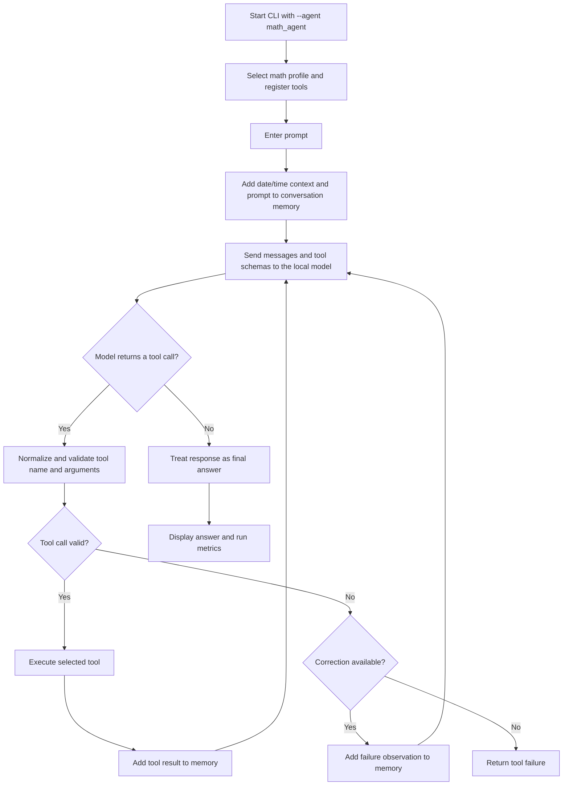

# NanoAgent

> **Work in progress:** NanoAgent is an experimental local-model agent. Interfaces,
> tool behavior, and documentation may change as the project develops. 

NanoAgent is a small Python project for exploring how a language model can decide
when to call tools, use their results, and return a final answer. It connects to a
local OpenAI-compatible chat-completions server (such as `llama-server`) and runs
an iterative ReAct-style agent loop.

The CLI shows progress and selected tools while a request is running, then prints
the final answer. It does **not** display the model's private reasoning.

Each run is also appended to `nanoagent.jsonl` in the current directory. The
JSONL log includes the messages and tool schemas sent to the model, model
responses (including any returned reasoning), tool calls and results, errors,
and final answers. Use `--log-file <path>` to choose another file. Logs may
contain sensitive prompt content; protect or remove them as appropriate.

## Current capabilities

- Local model endpoint and model name are configurable from the command line.
- Native function/tool calling with a maximum of 10 agent steps per request.
- Tool arguments are validated against the schemas advertised to native models.
  Duplicate registrations are rejected, and text tool calls must be standalone
  JSON. Invalid calls and tool exceptions use classified failures.
- The code profile can find files, search variables/functions/classes in Python
  files, inspect Python file structure, search literal text or regular
  expressions across workspace files with glob filters and context, read whole
  files or line ranges, create/edit workspace files, run Python snippets or
  files, and run the project's `unittest` suite after approval. File access is
  limited to the current workspace.
- The code agent can create and edit Python files in the workspace without
  approval.
- Python and test execution require explicit approval and have time and output
  limits. They run with the current process's permissions and are not sandboxed.
- Three selectable profiles expose tools from only one tool module each:
  `math_agent` uses `math_tools.py`, `code_agent` uses `code_tools.py`, and
  `file_agent` uses `file_tools.py`.
- Calculator, expression plotting, web search, and date/time tools.
- Conversation memory keeps the system instructions and the latest complete
  turns. Use `/clear` to clear conversation history.
- Time-sensitive requests receive the current date and time in the
  `Asia/Kolkata` timezone. Web-search results include a retrieval time and a
  publication date when the search provider supplies one.
- Web search is limited to two distinct searches per request; repeated queries
  reuse the earlier result. Each search returns three results by default and
  uses a five-second DDGS timeout.
- An unknown tool or structurally invalid tool call can receive one correction
  attempt. Provider failures, timeouts, rate limits, and denied permissions stop
  the current run instead of triggering automatic retries.

## Requirements

- [LFM3-1.7B download link](https://huggingface.co/LiquidAI/LFM3-1.7B-GGUF/tree/main)
- Python 3.12 or newer
- [uv](https://docs.astral.sh/uv/)
- A running local server that exposes an OpenAI-compatible
  `/v1/chat/completions` endpoint

To serve the LFM
model with `llama.cpp`, start the server like this:

```powershell
llama-server -m .\LFM3-1.7B-Q4_K_M.gguf --port 8080 -c 16384 -np 1  -t 4 -b 512 -ub 128 --metrics
```

NanoAgent reads llama.cpp's `/slots` endpoint after each task and reports the
aggregate last-prompt token count relative to total slot context capacity. This
is prompt-context usage, not KV-cache memory in bytes. If `/slots` does not
expose the counts, NanoAgent can use `llamacpp:kv_cache_usage_ratio` from the
metrics endpoint when available.

Enable llama.cpp's Prometheus metrics endpoint for that fallback:

```powershell
llama-server -m .\LFM3-1.7B-Q4_K_M.gguf --port 8080 --metrics
```

The server must expose the `llamacpp:kv_cache_usage_ratio` metric; NanoAgent
reports the utilization as unavailable if that metric is not provided. Enabling
`--metrics` only enables the endpoint; it does not guarantee that the server
exports KV-cache occupancy.

In another terminal, install the project dependencies and start NanoAgent:

```powershell
uv sync
uv run nanoagent
```

By default, the CLI connects to `http://127.0.0.1:8080/v1/chat/completions` and
sends the model name `LFM3-1.7B`. If your server expects a different model name
or endpoint, configure them with:

```powershell
uv run nanoagent --model <server-model-name> --api_base <chat-completions-url>
```

Choose the initial profile with `--agent`:

```powershell
uv run nanoagent --agent math_agent
```

Switch profiles during a session with `/agent math_agent`, `/agent code_agent`,
or `/agent file_agent`. Each profile keeps its own conversation memory.
`/skills` lists the profiles and their responsibilities.

Use `uv run nanoagent --help` to see all command-line options.

## Agent flow: prompt to final answer

For example, start the math profile:

```powershell
uv run nanoagent --agent math_agent
```

Then enter:

> Solve `x^2 - 5x + 6 = 0`, evaluate it at `x = 2` and `x = 5`, and plot it
> for `x` from -10 to 10.

The CLI creates the model client and agent profiles, then activates
`math_agent`. The math profile makes `calculator`, `plot_expression`, and
`get_date_and_time` available. Its instructions are included in the system
message; native function-tool schemas are sent separately with each model
request.



For this request, the model may call tools in an order like this (the exact
calls depend on the model):

```text
calculator(operation="solve", expression="x**2 - 5*x + 6", variable="x")
→ Result: [2, 3]

calculator(operation="calculate", expression="2**2 - 5*2 + 6")
→ Result: 0

calculator(operation="calculate", expression="5**2 - 5*5 + 6")
→ Result: 6

plot_expression(
  expression="x**2 - 5*x + 6",
  x_min=-10,
  x_max=10,
  filename="math_plot.png"
)
→ Success: Plot saved successfully to 'math_plot.png'.
```

After each tool call, NanoAgent adds the result to the conversation and sends
the updated messages to the model. When the model responds without another
tool call, that response is the final answer. For example:

> Factoring gives `(x - 2)(x - 3) = 0`, so the roots are `x = 2` and `x = 3`.
> The expression evaluates to `0` at `x = 2` and `6` at `x = 5`. The plot was
> saved as `math_plot.png`.

The CLI reports progress and selected tools but does not display private model
reasoning. Run events, model requests and responses, tool calls and results,
and final answers are appended to `nanoagent.jsonl` by default. Logs may
contain sensitive prompt content.

## CLI commands

- `/help` — list commands
- `/multiline` — enter a prompt across multiple lines; enter `/send` on its own
  line to submit, or `/cancel` to discard it. You can paste a multiline prompt
  directly after entering this mode.
- `/clear` — clear conversation history while keeping system instructions
- `/memory` — inspect the current message history
- `/model` — show the configured model name
- `/tools` — list registered tools
- `/skills` — list the available agent profiles
- `/agent <name>` — switch agent profile for subsequent requests
- `exit` or `quit` — leave the CLI

## Work in progress and limitations

- **Live information is not guaranteed.** Web search currently uses DDGS search
  results; it is not a dedicated live market-data or sports-score feed. A search
  retrieval time is not proof that the result itself is current.
- **Model generation is blocking.** The CLI can show progress stages, but it
  does not yet stream generated tokens from the server.
- **Code execution is not a security sandbox.** Python snippets, files, and
  tests run with the current process's permissions. Only run code you trust.
- **Agent behavior depends on the selected model and server.** Tool selection,
  argument quality, and response quality can vary.
- **This project is intended for experimentation and learning**, not unattended
  or high-stakes use.