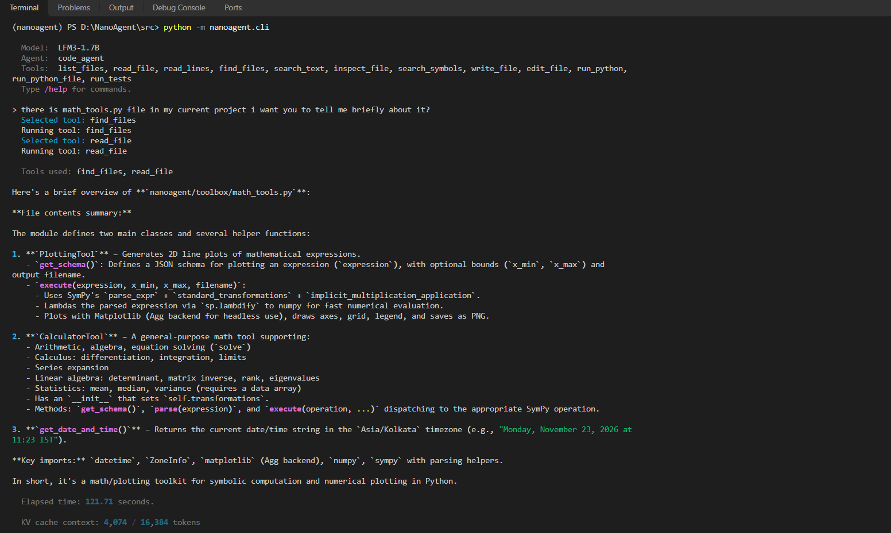
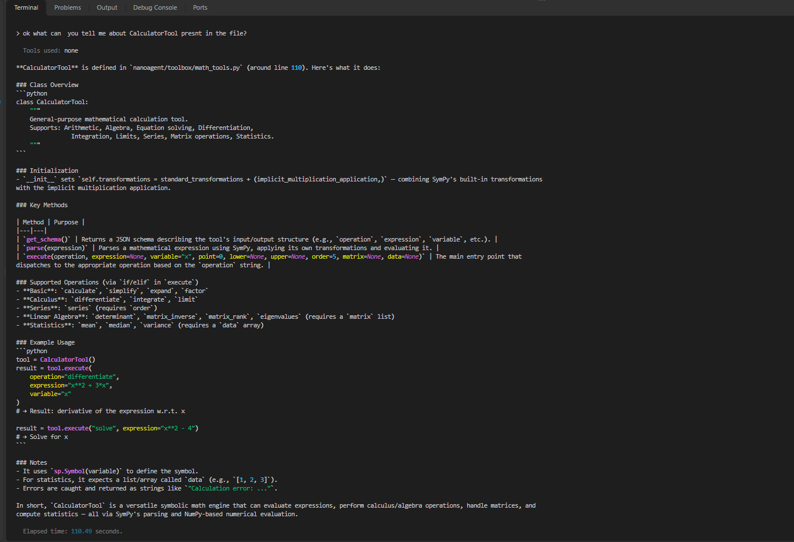

# Example 1: Asking the Code Agent About a Python File

## Setup

I run the local model with this command:

```powershell
llama-server -m .\LFM3-1.7B-Q4_K_M.gguf --port 8080 -c 16384 -np 1 -t 4 -b 512 -ub 128
```

This example runs on my PC using only the CPU, with no GPU, and uses a 4-bit
quantized model. Responses can be slow in this setup. A model with higher
precision, such as 8-bit or bfloat16, may produce better results, but it also
requires more memory.

## Prompt 1: Ask about a file

> There is a `math_tools.py` file in my project. Briefly explain what it does.



## Prompt 2: Ask about a class

> What can you tell me about the `CalculatorTool` class in that file?


