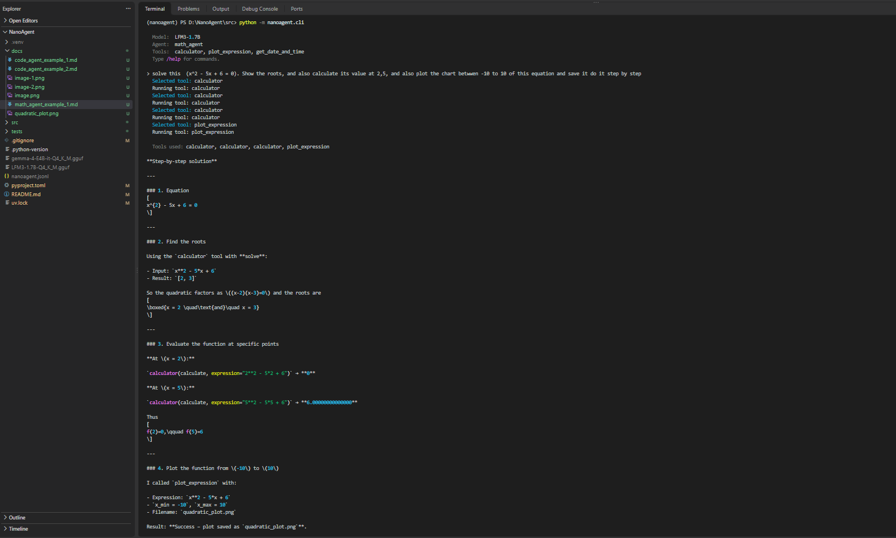
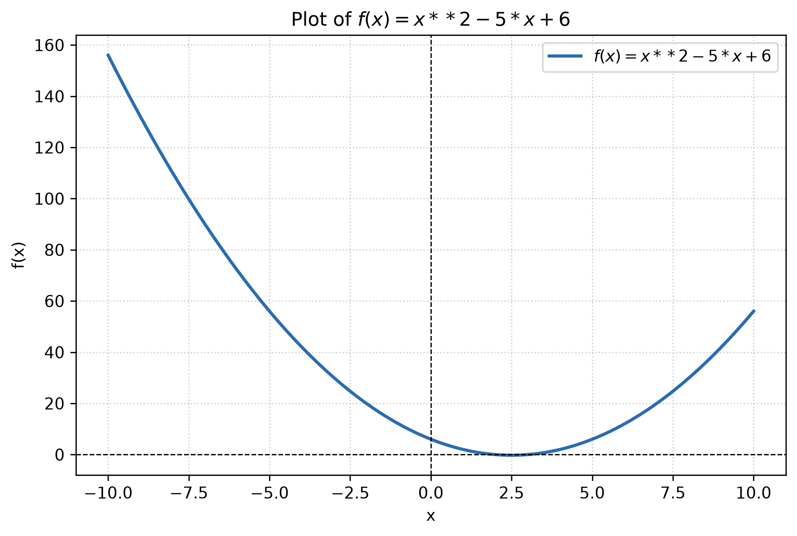

# Example 1: Solving and Plotting a Quadratic

## Setup

I start the local model with this command:

```powershell
llama-server -m .\LFM3-1.7B-Q4_K_M.gguf --port 8080 -c 16384 -np 1 -t 4 -b 512 -ub 128
```

I run the model on my PC using only the CPU, with no GPU. It is quantized to
4-bit, so responses can be slow. A higher-precision model, such as 8-bit or
bfloat16, may produce better results, but it also requires more memory.

## Request

> Solve the equation `x^2 - 5x + 6 = 0` and show its roots. Then evaluate
> `x^2 - 5x + 6` at `x = 2` and `x = 5`. Finally, plot
> `y = x^2 - 5x + 6` for `x` from -10 to 10, save the plot, and explain the
> steps.



## Generated plot

