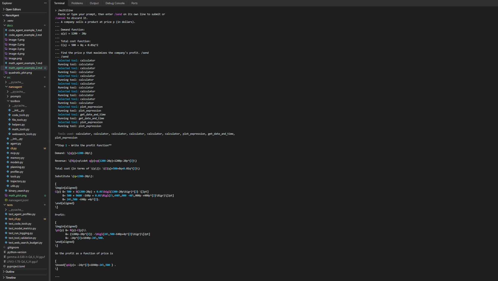
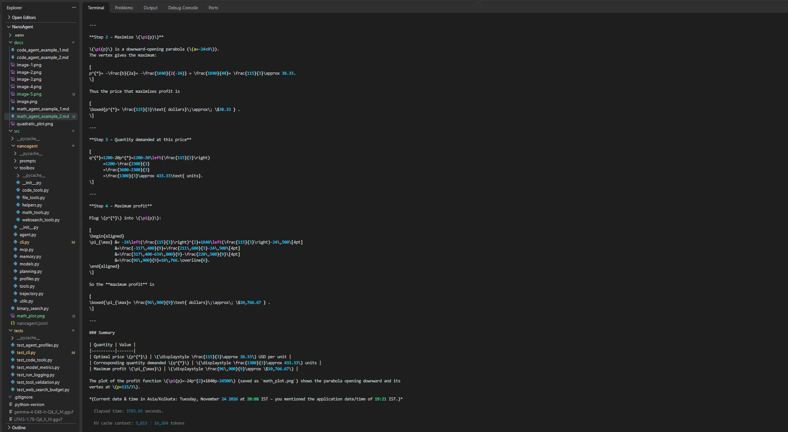
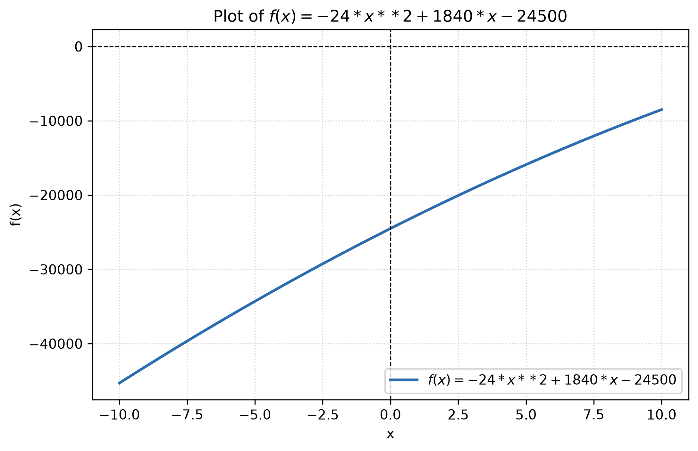

# Example 2: Maximizing Product Profit

## Setup

Start the local model with:

```powershell
llama-server -m .\LFM3-1.7B-Q4_K_M.gguf --port 8080 -c 16384 -np 1 -t 4 -b 512 -ub 128
```

This example runs on a CPU without a GPU, using a 4-bit quantized model.
Responses may be slow. A higher-precision model, such as 8-bit or bfloat16,
may produce better results but requires more memory.

## Problem

A company sells a product for `p` dollars per unit. The number of units sold at
that price is modeled by the demand function:

```text
q(p) = 1200 - 20p
```

The total cost of producing `q` units is:

```text
C(q) = 500 + 8q + 0.01q²
```

Find the price `p` that maximizes profit.





## Profit function plot


